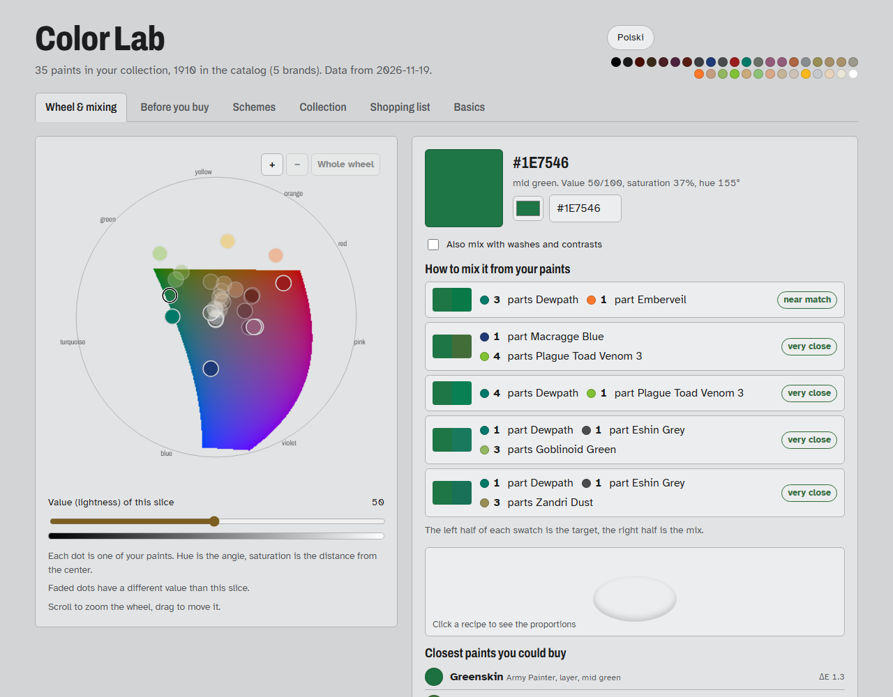
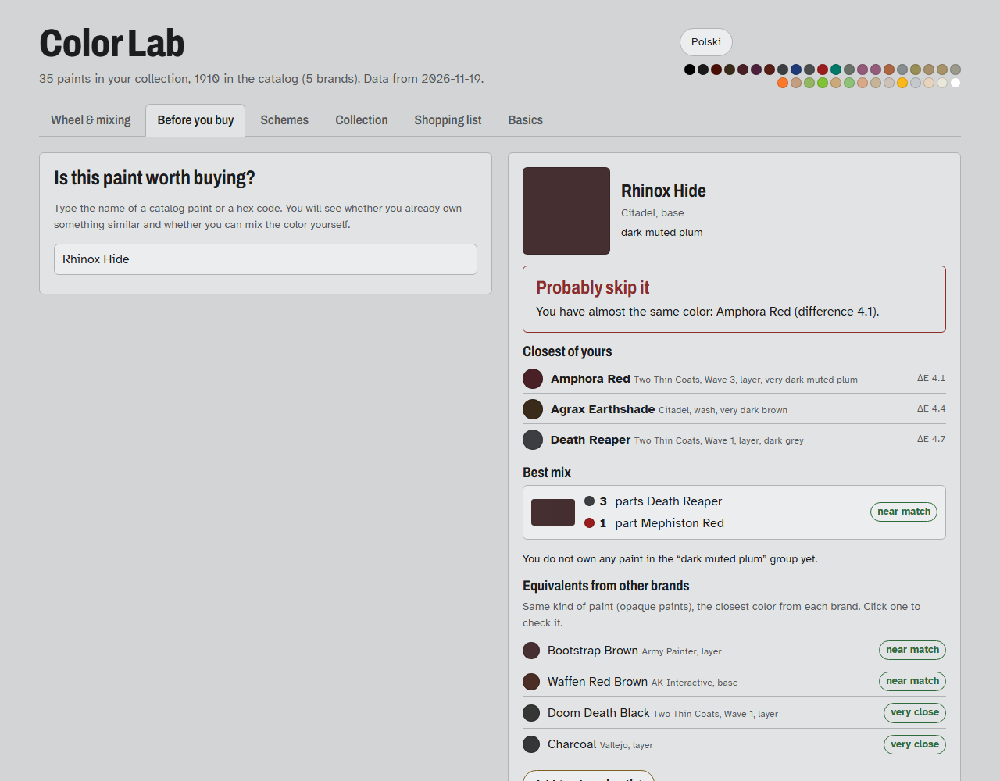
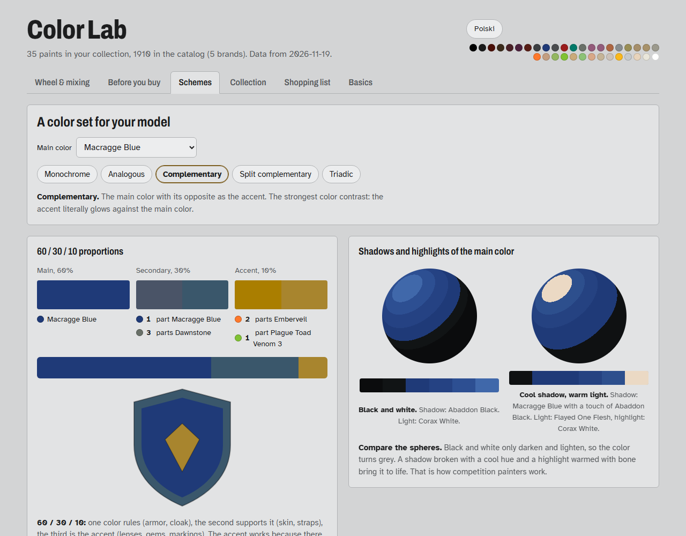
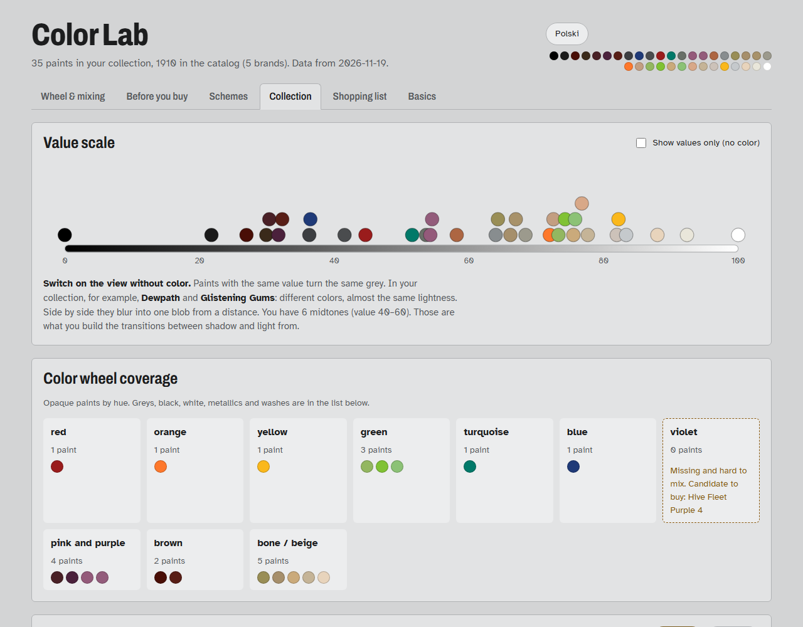
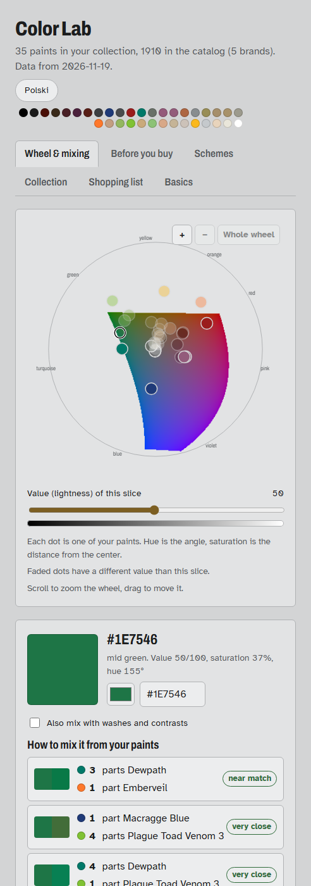

# minipainter Color Lab

**A color-theory workbench built on top of [minipainter](https://github.com/ArturSkowronski/minipainter).** minipainter keeps your miniature paint collection. Color Lab turns that collection into a single page that tells you what you can mix from it, what you are missing, and what a paint from a tutorial is called in other brands.

There is no server and no shared database. Each person builds their own page from their own minipainter inventory, so the page always shows *your* paints. If you use Claude Code, a bundled hook rebuilds the page whenever Claude changes your inventory and can keep a private claude.ai Artifact up to date, so the same page works on your phone in the hobby store.

The interface is in **English and Polish** (switch in the top right corner; the default follows your browser language).



## Who it is for

People starting out in the hobby. New painters often buy paints they do not need, shade everything with black and white, and choose schemes by guesswork. Color Lab answers the practical questions with the paints you already own:

- Can I mix this color, and in what ratio?
- Do I really need that dark brown, or do I already have two?
- What paints am I missing, and which brand's paint is closest to the one in the video I am following?
- Which three colors work together on this model, and how do I shade them?

Along the way it explains the theory behind the answers: hue, value and saturation, why mixing dulls color, complementary colors, warm light and cool shadow, and the 60/30/10 rule.

## What it does

| Tab | What you get |
|---|---|
| **Wheel & mixing** | Your paints on an OKLCH color wheel, with a value slider and zoom. Click any point and get up to five recipes from paints you own, such as "3 parts Macragge Blue + 1 part Corax White", with a target vs. result swatch, a closeness rating and an animated mixing well. Below that, the closest paints you could buy. |
| **Before you buy** | Search any catalog paint or type a hex code. You get a verdict (already own it, probably skip it, you can mix it, fills a gap), your closest paints, the best mix from your collection, how many paints you already have in that color group, and the **closest equivalent from every other brand** (Citadel, Vallejo, Army Painter, AK Interactive and any extra ranges you add). One click puts it on the shopping list. |
| **Schemes** | Pick a main color and a harmony (monochrome, analogous, complementary, split complementary, triadic). You get a 60/30/10 set from your own paints, a shield preview, and two shaded spheres that compare black-and-white shading with cool shadows and warm highlights. A second mode lists Space Marine chapters by gene-seed line, armor color or name: each chapter's armor, second color and details matched to your paints and the closest store paint, plus suggested extras that suit the scheme (metal, lenses, leather, parchment, wax seals, base, armor wash). |
| **Collection** | A value scale of your paints with a grayscale toggle, hue coverage with the gaps you can or cannot fill by mixing, and the full list grouped by type or brand. |
| **Shopping list** | Paints you plan to buy, each with substitutes from other brands in case the store does not stock that exact one. Synced between devices when the page runs as a claude.ai Artifact, stored in the browser otherwise. |
| **Basics** | Short lessons on color, each linked to the tool where you can try it. |

Mixing uses a single-constant Kubelka–Munk pigment model on linear RGB rather than averaging RGB, so blue and yellow give a dull dark green, the way they do on a real palette.

| Before you buy | Schemes |
|---|---|
|  |  |

| Collection | On a phone |
|---|---|
|  |  |

## Setup

Requires Node.js 18+ and minipainter.

```bash
npm install -g minipainter
mpaint inventory own citadel/abaddon-black     # mark the paints you own (or use the minipainter TUI or MCP server)

git clone https://github.com/gltshhh/minipainter-color-lab.git
cd minipainter-color-lab
node build.mjs                                 # writes data.js and index.html from your inventory
```

Open `index.html` in a browser. Everything runs locally. The page needs an internet connection only to load web fonts.

Run `node build.mjs` again whenever your inventory changes, or let the Claude Code hook below do it for you.

### Build options

| Flag | Default |
|---|---|
| `--catalog <dir>` | `<npm root -g>/minipainter/data/catalog`, or a local `node_modules/minipainter` |
| `--inventory <file>` | `$MINIPAINTER_INVENTORY`, else `~/.minipainting/inventory.json` |
| `--extras <file>` | `./extras.json` (optional) |
| `--overrides <file>` | `./overrides.json` (optional) |

### Paints missing from the catalog

Put them in `extras.json` with a hex color (see [`extras.example.json`](extras.example.json)):

```json
[
  { "name": "Dewpath", "brand": "Army Painter", "series": "Warpaints Fanatic", "hex": "#007969", "role": "layer" },
  { "name": "White Star", "brand": "Two Thin Coats", "series": "Wave 1", "hex": "#f7fcf7", "role": "layer", "owned": false }
]
```

Paints without `"owned": false` count as yours: they show up on the wheel and in mixing recipes. Paints with `"owned": false` are added to the catalog only, so you can search them, compare them and get them as equivalents. That is a quick way to add a whole range minipainter does not ship yet. `role` is one of `base`, `layer`, `shade`, `contrast`, `speedpaint`, `ink`, `metallic`, `technical`, `air`, `dry`.

### Correcting catalog colors

Catalog colors are reference values and some are off. If you have better ones, put them in `overrides.json`, keyed by minipainter id:

```json
{ "colors": { "citadel/mournfang-brown": "#5d2e1c" } }
```

### Chapter colors

The Schemes tab has a **Chapter colors** mode built from `chapters.json`, which ships with the repository: 269 Space Marine chapters with their gene-seed line, status and colors. You can group them by gene-seed line, armor color or name. For each chapter you get the armor, second color and details matched to your paints and to the closest store paint, plus suggested extras that fit the scheme.

The data is derived from the [Pictorial List of Space Marine Chapters](https://warhammer40k.fandom.com/wiki/Pictorial_List_of_Space_Marine_Chapters_(A-L)) on the Warhammer 40k Wiki (Fandom), which is licensed [CC BY-SA 3.0](https://creativecommons.org/licenses/by-sa/3.0/). `chapters.json` is therefore also CC BY-SA 3.0, unlike the MIT code. No wiki text or images are copied:

- names come from the list tables,
- gene-seed line and status are inferred from the summaries with keyword rules (the line stays unknown when the summary does not name one),
- colors are sampled from each chapter's illustration: the background is removed by flood fill from the edges, pixels are clustered with k-means in OKLab, and shades of one hue are merged.

Illustrations are darker and duller than paint, so treat the colors as a direction. `tools/chapters/` holds the scripts and explains how to regenerate the file. Use `--chapters <file>` to build with a different file.

## Keep it in sync with Claude Code

minipainter ships an MCP server, so you can manage your collection by talking to Claude ("I just bought Rhinox Hide and Nuln Oil"). Color Lab adds a Claude Code hook that rebuilds the page every time Claude changes your inventory through that server. Add paints in chat, reload the page, and they are on the wheel.

1. Register the minipainter MCP server in your project (`.mcp.json`):

   ```json
   {
     "mcpServers": {
       "minipainter": { "command": "minipainter-mcp" }
     }
   }
   ```

   On Windows, use `"command": "node"` with `"args": ["<npm root -g>/minipainter/src/mcp-server.mjs"]` instead.

2. Add the hook to `.claude/settings.json` in the same project, with the path to your Color Lab checkout:

   ```json
   {
     "hooks": {
       "PostToolUse": [
         {
           "matcher": "mcp__minipainter__inventory_mark_owned|mcp__minipainter__inventory_mark_unowned",
           "hooks": [
             { "type": "command", "command": "node /path/to/minipainter-color-lab/hooks/claude-code-sync.mjs", "timeout": 60 }
           ]
         }
       ]
     }
   }
   ```

3. Restart Claude Code. You can review or disable the hook under `/hooks`.

### On your phone, as a claude.ai Artifact

A local file does not travel with you. If you use claude.ai, ask Claude Code to publish `app.html` together with `data.js` as a private Artifact, then put its link in the same settings file:

```json
{ "env": { "COLOR_LAB_ARTIFACT_URL": "https://claude.ai/artifact/..." } }
```

With that set, the hook also asks Claude to republish the Artifact once after each batch of inventory changes, so the page on your phone is always current. As an Artifact, the shopping list is stored in the Artifact's own database and is the same on every device you open it on.

The hook runs only in Claude Code. If you change your inventory another way (the `mpaint` CLI, the TUI or Claude Desktop), run `node build.mjs` yourself.

## Files

| File | Role |
|---|---|
| `app.html` | the whole app: markup, styles, script and the English/Polish strings |
| `build.mjs` | reads minipainter's catalog and your inventory, writes `data.js`, wraps `app.html` into `index.html` |
| `hooks/claude-code-sync.mjs` | Claude Code hook that rebuilds after inventory changes made through MCP |
| `extras.example.json` | example of paints missing from the catalog |
| `chapters.json` | Space Marine chapter colors (CC BY-SA 3.0, from the Warhammer 40k Wiki) |
| `tools/chapters/` | scripts that build `chapters.json` from the wiki pages |
| `docs/` | screenshots for this README |

Your own data stays out of the repository: `data.js`, `index.html`, `extras.json` and `overrides.json` are in `.gitignore`.

## Accuracy

Catalog colors are approximate, and the mixing model simplifies real pigments. Washes and contrasts are recorded inconsistently across brands (some as the color in the pot, some as the color over white primer), so their equivalents are hints. Treat every recipe as a starting point: mix a few drops on a wet palette, try it on a spare model and adjust by eye.

## Contributing

Issues and pull requests are welcome, especially:

- translations (the strings are in `app.html`: Polish in the markup, English in the `EN_UI` dictionary and in `T('polski', 'English')` calls),
- corrections to catalog colors, which are best sent upstream to [minipainter](https://github.com/ArturSkowronski/minipainter) so every tool benefits,
- feedback from people actually painting with the recipes.

## Credits

Paint catalog and inventory: [minipainter](https://github.com/ArturSkowronski/minipainter) by Artur Skowroński (MIT). Color space: [OKLab](https://bottosson.github.io/posts/oklab/) by Björn Ottosson. Fonts: Archivo and Atkinson Hyperlegible from Google Fonts. Chapter data: derived from the [Warhammer 40k Wiki](https://warhammer40k.fandom.com/) (Fandom), CC BY-SA 3.0.

This is an independent community project. It is not affiliated with minipainter, Games Workshop, Vallejo, The Army Painter or AK Interactive. Paint names are trademarks of their owners and are used only to identify the paints.

## License

Code: [MIT](LICENSE). `chapters.json`: [CC BY-SA 3.0](https://creativecommons.org/licenses/by-sa/3.0/), derived from the Warhammer 40k Wiki (Fandom).
